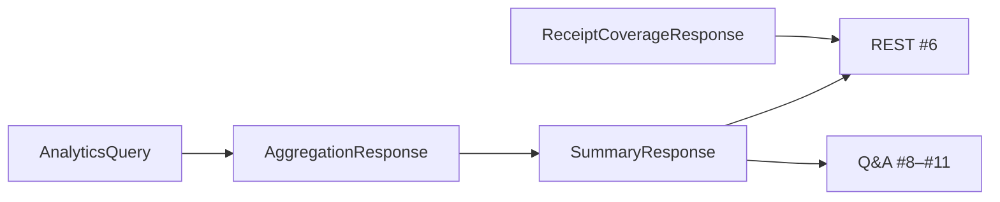

# Analytics schema

Module 4 **data contract** for spending analytics: time ranges, category filters,
aggregation, deduplication, and structured summaries.

📌 **Source of truth** for shapes shared by aggregation (#4), summaries (#5),
REST (#6), and Q&A (#8–#11). Pydantic mirrors live in
[`app/analytics_models.py`](../app/analytics_models.py).

| Upstream | Link |
|----------|------|
| Category taxonomy | [n8n categorization-schema.md](https://github.com/RoxanaTapia/receipt-intelligence-n8n/blob/main/docs/categorization-schema.md) |
| Receipt files on disk | [n8n data/README.md](https://github.com/RoxanaTapia/receipt-intelligence-n8n/blob/main/data/README.md) |

| Layer | Issue | Implementation |
|-------|-------|----------------|
| Aggregation + dedup | #4 | [`app/aggregation.py`](../app/aggregation.py) |
| Structured summaries | #5 | [`app/summary.py`](../app/summary.py) |
| REST endpoints | #6 | [`app/routers/analytics.py`](../app/routers/analytics.py) |
| Receipt coverage | #6 | [`app/coverage.py`](../app/coverage.py) |



## Contents

1. [Date semantics](#date-semantics)
2. [Time ranges](#time-ranges)
3. [Category filters](#category-filters)
4. [Aggregation](#aggregation)
5. [Receipt deduplication](#receipt-deduplication-policy)
6. [Structured summaries](#structured-summaries)
7. [REST query parameters](#rest-query-parameters)
8. [Receipt coverage](#receipt-coverage)
9. [Pydantic mapping](#pydantic-mapping)
10. [Related docs](#related-docs)

## Date semantics

| Field | Role in analytics |
|-------|-------------------|
| Receipt **`date`** | Transaction date (`YYYY-MM-DD`). **All time-range filters use this field.** |
| **`categorized_at`** | When categorization was written. Used only to pick a dedup **winner**, never as the spend date. |
| Filename date segment | Same transaction date as JSON `date` (see n8n data README). |

## Time ranges

Exactly **one** mode per query. Inclusive bounds on transaction `date`.

| Mode | Fields | Resolved window (reference day = `as_of`, usually today) |
|------|--------|----------------------------------------------------------|
| `last_week` | `preset: last_week` | `as_of - 6 days` … `as_of` (7 calendar days) |
| `last_month` | `preset: last_month` | `as_of - 29 days` … `as_of` (30 calendar days) |
| `last_N_days` | `preset: last_N_days`, `n_days: N` (`N ≥ 1`) | `as_of - (N - 1) days` … `as_of` |
| Explicit | `start_date`, `end_date` | Those dates, inclusive (`start_date ≤ end_date`) |

Rolling windows (not calendar week/month boundaries) keep “last week” stable across locales.

### Example query objects

```json
{ "time_range": { "preset": "last_week" }, "categories": null }
```

```json
{ "time_range": { "preset": "last_N_days", "n_days": 14 }, "categories": ["food", "drinks"] }
```

```json
{
  "time_range": { "start_date": "2026-05-01", "end_date": "2026-05-19" },
  "categories": ["household"]
}
```

## Category filters

| Filter | Meaning |
|--------|---------|
| `categories: null` or `[]` | All taxonomy values: `food`, `snacks`, `drinks`, `household`, `other` |
| One or more values | Only line items in those categories (after dedup) |

Categories come from the upstream taxonomy; unknown strings fail validation.

## Aggregation

Every aggregation response exposes:

| Unit | Field | Meaning |
|------|-------|---------|
| Total spend | `total_spend` | Sum of included line-item `price` values (each `price` is the line total, matching upstream extraction) |
| Spend by category | `by_category[]` | Per-category `total_spend` and `line_item_count` |
| Line-item count | `line_item_count` | Number of line items included |
| Receipt count | `receipt_count` | Number of **deduplicated** logical receipts included |

Resolved `start_date` / `end_date` on the response always reflect the effective window
(after preset resolution).

### Aggregation response shape

```json
{
  "start_date": "2026-05-10",
  "end_date": "2026-05-16",
  "categories": null,
  "total_spend": 24.5,
  "receipt_count": 1,
  "line_item_count": 4,
  "by_category": [
    { "category": "food", "total_spend": 18.0, "line_item_count": 3 },
    { "category": "drinks", "total_spend": 6.5, "line_item_count": 1 }
  ],
  "deduplication": {
    "deduplicated_count": 1,
    "superseded_files": ["2026-05-15_rewe_aaaaaaaa.json"]
  }
}
```

## Receipt deduplication policy

n8n may keep **multiple hash-named files** for one shopping trip when extraction or
categories drift across re-runs (see
[n8n data/README.md — Re-runs and multiple files](https://github.com/RoxanaTapia/receipt-intelligence-n8n/blob/main/data/README.md)).
The loader (#2) reads every valid file; analytics must collapse duplicates or totals
**double-count**.

| Concept | Rule |
|---------|------|
| **Logical receipt key** | `(date, merchant, canonical line items)` — each line item compared by `description`, `quantity`, `price`. **Category is excluded** from identity so a re-categorized trip still matches. |
| **Winner** | File with the latest `categorized_at`. Fallback: file mtime if the timestamp is missing. |
| **Effect** | Aggregation uses one version per logical receipt; older hash files are ignored for totals. |
| **Transparency** | Response `deduplication.deduplicated_count` is required; `superseded_files[]` is optional debug detail. |

### Merchant variance

If Claude emits different merchant strings (`"REWE"` vs `"REWE Markt"`), logical keys
**do not** match — both files can contribute to totals. That matches the n8n note that
merchant variance creates separate files; cleanup is operational, not silent merge by slug.

### Worked example

Two files, same shopping trip, categories changed on re-run:

| File | `date` | `merchant` | Line items (desc / qty / price) | Categories | `categorized_at` |
|------|--------|------------|----------------------------------|------------|------------------|
| `2026-05-15_rewe_aaaaaaaa.json` | `2026-05-15` | `REWE` | Milk / 1 / 1.19 | `other` | `2026-05-15T10:00:00Z` |
| `2026-05-15_rewe_bbbbbbbb.json` | `2026-05-15` | `REWE` | Milk / 1 / 1.19 | `food` | `2026-05-16T09:00:00Z` |

- **Logical key** matches (category ignored).
- **Winner:** `…bbbbbbbb.json` (later `categorized_at`).
- **Totals:** Milk counts once under `food` (€1.19).
- **Metadata:** `deduplicated_count: 1`, optional
  `superseded_files: ["2026-05-15_rewe_aaaaaaaa.json"]`.

## Structured summaries

Summaries turn an `AggregationResponse` into percentages, top-N categories, a
period label, and template-filled `summary_facts[]`.

⚠️ Still **structured data**, not Claude prose. Narration comes later in Q&A
(#8–#11). Call `build_summary()` in [`app/summary.py`](../app/summary.py).

### Summary fields

| Field | Meaning |
|-------|---------|
| `period_label` | Human-readable window (see [Period labels](#period-labels)) |
| `by_category[]` | Aggregation rows plus `percentage` (0–100 share of `total_spend`, one decimal) |
| `top_categories[]` | Top-N by `total_spend` (default N = 3) |
| `summary_facts[]` | Structured claims: `fact`, `value`, `unit`, `text` |
| `period_delta` | Optional compare vs a previous `AggregationResponse` |

### Zero-total percentages

When `total_spend == 0`, every category **percentage is `0`** (e.g. `0%` spent
on a category). Do **not** return `null`, skip the fact, or divide by zero.

⚠️ `0%` means share of a **zero total** (empty period or free items only). It does
not by itself mean “we saw that category and it cost nothing.” Q&A should not
over-interpret empty periods.

The same rule applies to optional `period_delta.percent_change` when the
previous period’s `total_spend` is `0`.

### Period labels

| Input | `period_label` |
|-------|----------------|
| Preset `last_week` | `last 7 days` |
| Preset `last_month` | `last 30 days` |
| Preset `last_N_days` | `last {N} days` |
| Full calendar month (explicit) | e.g. `March 2024` |
| Other explicit ranges | e.g. `10 May 2026 to 16 May 2026` |

### Summary fact keys

| `fact` | `value` / `unit` | When present |
|--------|------------------|--------------|
| `category_share` | percentage / `%` | One per category in `by_category` |
| `top_category` | category name / `null` | When `top_categories` is non-empty |
| `period_delta_pct` | percent change / `%` | When a previous aggregation is supplied |

Template patterns (filled into `SummaryFact.text`):

- `"You spent {pct}% on {category} {period_label}."`
- `"Your top category {period_label} was {category} ({amount} EUR)."`

### Summary response shape

```json
{
  "start_date": "2026-05-10",
  "end_date": "2026-05-16",
  "period_label": "last 7 days",
  "total_spend": 24.5,
  "by_category": [
    {
      "category": "food",
      "total_spend": 18.0,
      "percentage": 73.5,
      "line_item_count": 3
    },
    {
      "category": "drinks",
      "total_spend": 6.5,
      "percentage": 26.5,
      "line_item_count": 1
    }
  ],
  "top_categories": [
    {
      "category": "food",
      "total_spend": 18.0,
      "percentage": 73.5,
      "line_item_count": 3
    }
  ],
  "summary_facts": [
    {
      "fact": "category_share",
      "value": 73.5,
      "unit": "%",
      "text": "You spent 73.5% on food last 7 days."
    },
    {
      "fact": "top_category",
      "value": "food",
      "unit": null,
      "text": "Your top category last 7 days was food (18.00 EUR)."
    }
  ],
  "period_delta": null
}
```

## REST query parameters

`GET /analytics/spending` and `GET /analytics/summary` accept flat query params that
map to [`AnalyticsQuery`](../app/analytics_models.py) (see
[`build_analytics_query`](../app/routers/analytics.py)):

| Query param | Maps to | Notes |
|-------------|---------|-------|
| `preset` | `time_range.preset` | `last_week`, `last_month`, or `last_N_days` |
| `n_days` | `time_range.n_days` | Required when `preset=last_N_days` (`≥ 1`) |
| `start_date` | `time_range.start_date` | With `end_date` for explicit mode (`YYYY-MM-DD`) |
| `end_date` | `time_range.end_date` | Inclusive |
| `categories` | `categories` | Repeatable; omit for all taxonomy values |

Exactly one time-range mode applies (same rules as [Time ranges](#time-ranges)).
Invalid combinations or unknown categories → **422** with a `detail` message.

Empty periods (no receipts in range) → **200** with `total_spend: 0`, empty
`by_category`, and `receipt_count: 0` (not an error — see
[Zero-total percentages](#zero-total-percentages)).

Live OpenAPI: `GET /docs` when the API is running.

## Receipt coverage

`GET /analytics/receipts` returns load + dedup observability (no time filter).

### Coverage response shape

```json
{
  "data_path": "../receipt-intelligence-n8n/data/receipts",
  "data_path_exists": true,
  "files_loaded": 4,
  "logical_receipt_count": 3,
  "line_item_count": 7,
  "earliest_date": "2026-05-10",
  "latest_date": "2026-05-19",
  "loaded_files": [
    "2026-05-10_aldi_aaaaaaaa.json",
    "2026-05-15_rewe_aaaaaaaa.json",
    "2026-05-15_rewe_bbbbbbbb.json",
    "2026-05-19_rewe_cccccccc.json"
  ],
  "deduplication": {
    "deduplicated_count": 1,
    "superseded_files": ["2026-05-15_rewe_aaaaaaaa.json"]
  }
}
```

| Field | Meaning |
|-------|---------|
| `files_loaded` | Valid JSON files read before dedup |
| `logical_receipt_count` | Winners after dedup |
| `earliest_date` / `latest_date` | Transaction-date span of logical receipts (`null` if none) |
| `deduplication` | Same metadata as aggregation |

## Pydantic mapping

| Concept | Model (`app/analytics_models.py`) |
|---------|-----------------------------------|
| Time range | `AnalyticsTimeRange`, `TimeRangePreset` |
| Query | `AnalyticsQuery` |
| Per-category row | `CategorySpend` |
| Dedup metadata | `DeduplicationMeta` |
| Aggregation result | `AggregationResponse` |
| Category share | `CategoryShare` |
| Summary fact | `SummaryFact` |
| Period delta | `PeriodDelta` |
| Summary result | `SummaryResponse` |
| Receipt coverage | `ReceiptCoverageResponse` |

| Service | Module |
|---------|--------|
| Aggregation | [`app/aggregation.py`](../app/aggregation.py) |
| Summaries | [`app/summary.py`](../app/summary.py) |
| Coverage | [`app/coverage.py`](../app/coverage.py) |
| REST routes | [`app/routers/analytics.py`](../app/routers/analytics.py) |

Receipt / line-item persistence shapes remain in [`app/models.py`](../app/models.py).

## Related docs

| Doc | Owner |
|-----|--------|
| [analytics.md](analytics.md) | End-to-end guide: architecture, setup, curl, dedup ops (**#7**) |
| [question-answering.md](question-answering.md) | Q&A routing contract, intent → `AnalyticsQuery` (**#9**; #11 completes) |
| This schema | **#3** (base contract); **#4** aggregation/dedup; **#5** summaries; **#6** REST/coverage |
