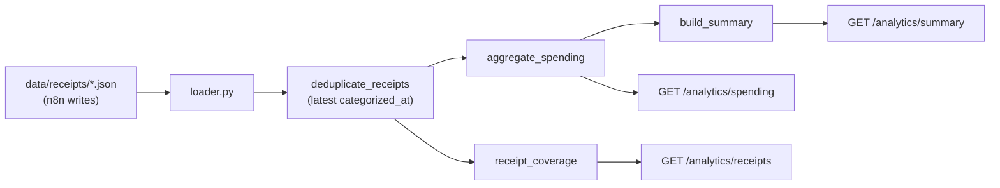

# Analytics guide

End-to-end guide: categorized receipt JSON on disk → load → dedup → aggregation → REST.

📌 **Schema contract** (time ranges, filters, response shapes, dedup policy):
[analytics-schema.md](analytics-schema.md).

**Upstream data:** [n8n data/README.md](https://github.com/RoxanaTapia/receipt-intelligence-n8n/blob/main/data/README.md)
(filenames, content hash, re-runs).

## Architecture



| Stage | Module | Role |
|-------|--------|------|
| Config | [`app/config.py`](../app/config.py) | Resolve `RECEIPT_DATA_PATH` |
| Load | [`app/loader.py`](../app/loader.py) | Read + validate every `*.json` |
| Dedup | [`app/aggregation.py`](../app/aggregation.py) | One winner per logical receipt |
| Aggregate | [`app/aggregation.py`](../app/aggregation.py) | Category totals over a time range |
| Summarize | [`app/summary.py`](../app/summary.py) | Structured facts from aggregation |
| Coverage | [`app/coverage.py`](../app/coverage.py) | Files loaded vs logical count |
| REST | [`app/routers/analytics.py`](../app/routers/analytics.py) | Thin HTTP adapter |

Routes stay thin: query params → `AnalyticsQuery` → service → response model
(see [analytics-schema.md](analytics-schema.md)).

## Historical data on disk

n8n appends categorized JSON under `data/receipts/` as you process PDFs over time.
Each file is one categorization run; the filename includes a **content hash**.

| Situation | What you see on disk |
|-----------|----------------------|
| First successful categorize | One new `YYYY-MM-DD_merchant_<hash>.json` |
| Re-run with same categories | Same hash → overwrite (updated timestamps) |
| Re-run with different categories | New hash → **second file** for the same trip |

So `ls data/receipts/` counts **files**, not necessarily **shopping trips**. Analytics
deduplicates before totaling — see [Deduplication](#deduplication) below.

Point this API at that directory with `RECEIPT_DATA_PATH` (default: sibling n8n path
in [`.env.example`](../.env.example)).

## Local setup and run

Prerequisites: Python 3.11+, sibling [receipt-intelligence-n8n](https://github.com/RoxanaTapia/receipt-intelligence-n8n)
with at least one categorized JSON in `data/receipts/`.

```bash
python3 -m venv .venv
source .venv/bin/activate
pip install -r requirements.txt
cp .env.example .env   # optional — default already points at sibling receipts
uvicorn app.main:app --reload
```

Smoke checks:

```bash
curl http://localhost:8000/health
# {"status":"ok"}

curl "http://localhost:8000/analytics/receipts"
# OpenAPI UI: http://localhost:8000/docs
```

Tests: `pytest`.

## Endpoint reference

Base URL: `http://localhost:8000`. Interactive docs: `/docs`.

| Method | Path | Purpose |
|--------|------|---------|
| `GET` | `/health` | Liveness |
| `GET` | `/analytics/spending` | Category totals for a time range |
| `GET` | `/analytics/summary` | Structured summary facts |
| `GET` | `/analytics/receipts` | Coverage + dedup debug (no time filter) |

### Query parameters (`/spending` and `/summary`)

Exactly **one** time-range mode. Full rules:
[Time ranges](analytics-schema.md#time-ranges) and
[REST query parameters](analytics-schema.md#rest-query-parameters).

| Param | Notes |
|-------|-------|
| `preset` | `last_week`, `last_month`, or `last_N_days` |
| `n_days` | Required when `preset=last_N_days` (`≥ 1`) |
| `start_date` / `end_date` | Explicit inclusive window (`YYYY-MM-DD`) |
| `categories` | Repeatable filter; omit for all |

Invalid combinations or unknown categories → **422**. Empty periods → **200** with
zero totals (not an error).

### curl examples

```bash
# Category totals — explicit range
curl "http://localhost:8000/analytics/spending?start_date=2026-05-01&end_date=2026-05-19"

# Drinks only — rolling window
curl "http://localhost:8000/analytics/spending?preset=last_N_days&n_days=14&categories=drinks"

# Structured summary facts
curl "http://localhost:8000/analytics/summary?preset=last_month"

# Coverage + dedup debug
curl "http://localhost:8000/analytics/receipts"
```

Response shapes: [Aggregation](analytics-schema.md#aggregation),
[Structured summaries](analytics-schema.md#structured-summaries),
[Receipt coverage](analytics-schema.md#receipt-coverage).

## Deduplication

⚠️ **Why this section exists:** a raw file count can be higher than spend
`receipt_count`. That is expected when re-categorization wrote a new hash file.

### Why multiple hash files exist

Category is part of n8n’s content hash. When Claude (or a fix) changes categories on
re-run, n8n writes a **new** file instead of overwriting. Older files often remain on
disk for audit. Details:
[n8n data/README.md](https://github.com/RoxanaTapia/receipt-intelligence-n8n/blob/main/data/README.md).

### How analytics picks a winner

| Concept | Rule |
|---------|------|
| **Logical key** | `(date, merchant, line items by description/qty/price)` — **category excluded** |
| **Winner** | Latest `categorized_at` (fallback: file mtime) |
| **Effect** | Totals use one version per trip; superseded files are ignored |

Full policy and worked example:
[Receipt deduplication policy](analytics-schema.md#receipt-deduplication-policy).

### How to verify

```bash
curl "http://localhost:8000/analytics/receipts"
```

Compare:

| Field | Meaning |
|-------|---------|
| `files_loaded` | Valid JSON files before dedup |
| `logical_receipt_count` | Winners after dedup |
| `deduplication.deduplicated_count` | How many files were superseded |
| `deduplication.superseded_files` | Filenames dropped from totals (when present) |

If `files_loaded` > `logical_receipt_count`, dedup is doing its job — spending totals
should match the logical set, not `ls | wc -l`.

## Related docs

| Doc | Contents |
|-----|----------|
| [analytics-schema.md](analytics-schema.md) | Contract: ranges, filters, shapes, dedup policy |
| [n8n data/README.md](https://github.com/RoxanaTapia/receipt-intelligence-n8n/blob/main/data/README.md) | Filename pattern, hash, re-runs |
| [n8n categorization.md](https://github.com/RoxanaTapia/receipt-intelligence-n8n/blob/main/docs/categorization.md) | Upstream categorize → disk pipeline |
| [AGENTS.md](../AGENTS.md) | Agent workflow for this repo |
| [README.md](../README.md) | Clone, env, quick start |
