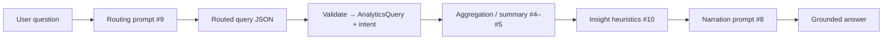

# Question answering — routing and narration

Design for mapping natural-language budget questions to analytics queries
(**#9**), narrating grounded answers (**#8** via `POST /questions`), and
budget/diet insight heuristics (**#10**). The full test matrix and setup
guide ship in **#11**.

⚠️ Capstone README / curl examples for Q&A are owned by **#11** — this doc
is the routing, narration, and insight-threshold contract.

📌 **Analytics contract:** [analytics-schema.md](analytics-schema.md)  
📌 **Upstream taxonomy:** [n8n categorization-schema.md](https://github.com/RoxanaTapia/receipt-intelligence-n8n/blob/main/docs/categorization-schema.md)  
📌 **Prompt style:** [n8n-claude-standards.md](https://github.com/RoxanaTapia/receipt-intelligence-n8n/blob/main/docs/n8n-claude-standards.md)

## Role of this document

| Consumer | How it uses this doc |
|----------|----------------------|
| **`app/qa_prompts.py`** | Distilled routing + narration prompts at runtime |
| **`app/qa_service.py`** | Validate routed JSON → analytics → narrate |
| **#11 test matrix** | Expected routing JSON for sample questions |

Claude receives a **distilled prompt** at runtime — not this markdown file.

## Pipeline (design)



| Stage | Owner | Rule |
|-------|-------|------|
| Interpret NL → structured query | Claude (routing) | Fuzzy synonyms, intent, time phrases |
| Validate JSON | Python / Pydantic | Fail closed on unknown categories or bad time modes |
| Compute totals / shares | Analytics layer | Deterministic — never invent amounts |
| Build budget/diet insights | Insight service (#10) | Rule-based; only for `general_insight` (and `GET /analytics/insights`) |
| Narrate answer | Claude (#8) | Use only facts from analytics / insights |

⚠️ **Do not** use Claude to invent spend amounts. Routing may guess *intent and filters*; money comes only from aggregation/summary.

## Intent types

Exactly **one** intent per question.

| Intent | When to use | Analytics path |
|--------|-------------|----------------|
| `spending_by_category` | How much spent (optionally in categories / period) | Aggregation: `total_spend`, `by_category` |
| `average_daily_spend` | Per-day average over the resolved window | Aggregation total ÷ inclusive day count |
| `category_share` | Share / percent of spend by category | Summary: `by_category[].percentage`, share facts |
| `period_comparison` | This period vs a previous period | Two aggregations + `period_delta` (see #5) |
| `general_insight` | Broad “how am I doing?” / budget-diet style | Summary + structured insights (see [Budget and diet insights](#budget-and-diet-insights-10)) |

### Routing rules (priority)

1. Prefer the **most specific** intent that matches the wording.
2. Words like *average*, *per day*, *daily* → `average_daily_spend` (even if a category is named).
3. Words like *percent*, *share*, *portion*, *how much of my spending* → `category_share`.
4. Words like *compared to*, *vs*, *more than last*, *week over week* → `period_comparison`.
5. Words like *insight*, *overview*, *how am I doing*, *budget and diet* → `general_insight`.
6. Otherwise → `spending_by_category` (default spend question).

If the question is empty or not about spending, set `"intent": null` and
`"error": "unsupported_question"` (validator rejects; #8 returns a refusal).

## Time-expression mapping

Map phrases to [time ranges](analytics-schema.md#time-ranges). Windows are
**rolling** relative to `as_of` (usually today), not calendar week/month
boundaries.

| Phrase (examples) | Routed `time_range` |
|-------------------|---------------------|
| “last week”, “past week”, “the last 7 days” | `{ "preset": "last_week" }` |
| “last month”, “past month”, “the last 30 days” | `{ "preset": "last_month" }` |
| “yesterday” | `{ "preset": "last_N_days", "n_days": 1 }` |
| “last N days”, “past N days”, “over the last N days” | `{ "preset": "last_N_days", "n_days": N }` (`N ≥ 1`) |
| “from DATE to DATE”, “between DATE and DATE”, “in May 2026” (if bounds clear) | `{ "start_date": "YYYY-MM-DD", "end_date": "YYYY-MM-DD" }` |
| No time mentioned | Default `{ "preset": "last_week" }` |

| Ambiguity | Rule |
|-----------|------|
| “this week” / “this month” | Treat as rolling `last_week` / `last_month` unless the user gives explicit dates |
| Unparseable date | `"time_range": null` + `"error": "ambiguous_time"` — do not guess a year |

## Category mapping

Allowed taxonomy values (lowercase): `food`, `snacks`, `drinks`, `household`,
`other`. Unknown tokens must **not** be invented — omit from `categories` or
set `"error": "unknown_category"`.

| Colloquial / synonym | Taxonomy |
|----------------------|----------|
| healthy food, groceries, ingredients, produce, meal, meals | `food` |
| snacks, treats, chips, candy, chocolate, sweets | `snacks` |
| drinks, beverages, soda, juice, coffee, water, soft drinks | `drinks` |
| household, cleaning, toiletries, personal care, detergent | `household` |
| other, miscellaneous, deposit, pfand | `other` |

| Filter rule | Routed `categories` |
|-------------|---------------------|
| One mapped category | `["food"]` (etc.) |
| Several mentioned | `["food", "drinks"]` (dedupe, taxonomy order optional) |
| No category / “everything” / “overall” | `null` (all categories) |
| Synonym not in table and not a taxonomy term | Prefer `null` + note in `warnings`, or `error` if the whole question hinges on that word |

## Routed query JSON (output contract)

Routing Claude returns **one JSON object** (no markdown fences). Fields
`time_range` and `categories` must match [`AnalyticsQuery`](../app/analytics_models.py)
so #8 can validate with the same Pydantic models.

```json
{
  "intent": "average_daily_spend",
  "time_range": { "preset": "last_week" },
  "categories": ["drinks"],
  "compare_to": null,
  "warnings": [],
  "error": null
}
```

| Field | Type | Notes |
|-------|------|-------|
| `intent` | string \| null | One of the five intents, or null on hard failure |
| `time_range` | object \| null | Same modes as [AnalyticsTimeRange](analytics-schema.md#time-ranges) |
| `categories` | string[] \| null | Taxonomy values only; null = all |
| `compare_to` | object \| null | For `period_comparison` only: previous window (`preset` or explicit dates). Default when null: immediately preceding window of the same length as `time_range` |
| `warnings` | string[] | Soft issues (e.g. defaulted time range) |
| `error` | string \| null | Hard failure code: `unsupported_question`, `ambiguous_time`, `unknown_category` |

### Example objects

**Spend on snacks last month**

```json
{
  "intent": "spending_by_category",
  "time_range": { "preset": "last_month" },
  "categories": ["snacks"],
  "compare_to": null,
  "warnings": [],
  "error": null
}
```

**Average daily drinks (default window)**

```json
{
  "intent": "average_daily_spend",
  "time_range": { "preset": "last_week" },
  "categories": ["drinks"],
  "compare_to": null,
  "warnings": ["defaulted_time_range_to_last_week"],
  "error": null
}
```

**Share of food last week**

```json
{
  "intent": "category_share",
  "time_range": { "preset": "last_week" },
  "categories": ["food"],
  "compare_to": null,
  "warnings": [],
  "error": null
}
```

## Routing prompt (three layers)

Follows the project three-layer pattern (system / task / output). Few-shots
below are part of the task layer for ambiguous questions.

### Production prompt

Copy into the #8 routing Claude call (substitute the user question):

```text
## System
You are a spending-query router for the Receipt Intelligence System.
Return one JSON object only — no markdown fences, no explanation.
Do not invent spend amounts, merchants, or receipt data. You only extract intent and filters.

## Task
Map the user question to a routed analytics query.

Intents (exactly one, or null with error):
- spending_by_category — how much spent (default)
- average_daily_spend — average / per day / daily
- category_share — percent / share / portion of spending
- period_comparison — compared to / vs / week over week / month over month
- general_insight — overview / insight / how am I doing / budget and diet

Time range (exactly one mode; rolling windows vs today):
- last_week → {"preset":"last_week"}
- last_month → {"preset":"last_month"}
- yesterday → {"preset":"last_N_days","n_days":1}
- last N days → {"preset":"last_N_days","n_days":N}
- explicit → {"start_date":"YYYY-MM-DD","end_date":"YYYY-MM-DD"}
- no time mentioned → {"preset":"last_week"} and add warning "defaulted_time_range_to_last_week"

Categories (taxonomy only): food, snacks, drinks, household, other.
Synonyms: healthy food/groceries/produce → food; treats/chips/candy → snacks;
soda/juice/coffee/water → drinks; cleaning/toiletries → household; pfand/deposit → other.
No category / overall → null. Never invent new category strings.

Period comparison: leave compare_to null unless the user names an explicit previous range; the API resolves the immediately previous equal-length window.

## Few-shot examples
Q: How much did I spend on healthy food last week?
→ {"intent":"spending_by_category","time_range":{"preset":"last_week"},"categories":["food"],"compare_to":null,"warnings":[],"error":null}

Q: What's my average daily spending on drinks?
→ {"intent":"average_daily_spend","time_range":{"preset":"last_week"},"categories":["drinks"],"compare_to":null,"warnings":["defaulted_time_range_to_last_week"],"error":null}

Q: What percent of my spending was snacks last month?
→ {"intent":"category_share","time_range":{"preset":"last_month"},"categories":["snacks"],"compare_to":null,"warnings":[],"error":null}

Q: How does my food spend last week compare to the week before?
→ {"intent":"period_comparison","time_range":{"preset":"last_week"},"categories":["food"],"compare_to":null,"warnings":["compare_to_defaults_to_previous_equal_window"],"error":null}

Q: Give me a simple budget and diet insight.
→ {"intent":"general_insight","time_range":{"preset":"last_week"},"categories":null,"compare_to":null,"warnings":["defaulted_time_range_to_last_week"],"error":null}

Q: How much on soda between 2026-05-01 and 2026-05-19?
→ {"intent":"spending_by_category","time_range":{"start_date":"2026-05-01","end_date":"2026-05-19"},"categories":["drinks"],"compare_to":null,"warnings":[],"error":null}

## Output format
{
  "intent": "<intent or null>",
  "time_range": { ... } | null,
  "categories": ["food"] | null,
  "compare_to": { ... } | null,
  "warnings": [],
  "error": null
}

User question:
{{QUESTION}}
```

### Few-shot pattern index

| # | Pattern | Intent | Notable mapping |
|---|---------|--------|-----------------|
| 1 | Category + “last week” | `spending_by_category` | “healthy food” → `food` |
| 2 | “Average daily” + category | `average_daily_spend` | Default time → `last_week` + warning |
| 3 | “Percent / share” | `category_share` | Snacks + `last_month` |
| 4 | “Compare to” prior period | `period_comparison` | `compare_to: null` → previous equal window |
| 5 | Budget / diet insight | `general_insight` | `categories: null` |
| 6 | Synonym + explicit dates | `spending_by_category` | “soda” → `drinks` |

## Parse → validate (#8)

After the routing call (`app/qa_service.py`):

| Step | Check |
|------|-------|
| Parse | Non-empty response; valid JSON object |
| Validate | `intent` in allowed set (or error path); `time_range` / `categories` via `AnalyticsQuery` rules |
| Fail closed | On `error` or validation failure → refuse; do not call aggregation with guessed filters |
| No receipts | If coverage shows zero files/logical receipts → refuse without calling Claude |

## Narration prompt (#8)

After analytics facts are computed, a second Claude call turns them into prose.
Amounts must come only from the facts JSON.

### Production prompt

Implemented in [`app/qa_prompts.py`](../app/qa_prompts.py) (`NARRATION_SYSTEM` +
`build_narration_user_message`). Distilled form:

```text
## System
You are a spending coach for the Receipt Intelligence System.
Answer in clear, concise prose using ONLY the structured facts provided.
Do not invent amounts, merchants, categories, or percentages that are not in the facts JSON.
If the facts show zero spend or an empty period, say so honestly — do not guess.
When facts include insights, treat them as spending-pattern observations only —
do not make health or nutritional claims.
Do not mention JSON, prompts, or that you are an AI unless asked.

## Task
Write a short answer to the user question grounded only in the facts below.
If the facts include an insights list, lead with those signals
(use each insight's text; do not invent extra metrics).

## User question
{{QUESTION}}

## Facts (JSON)
{{FACTS_JSON}}

## Output
Plain-text answer only — no markdown fences, no extra JSON wrapper.
```

### Endpoint shape

`POST /questions` with `{ "question": "..." }` returns
`{ "answer", "facts", "query", "meta?" }`. Set `ANTHROPIC_API_KEY` (see
[`.env.example`](../.env.example)). For `general_insight`, `facts.insights`
holds the structured insight list from
[`generate_insights()`](../app/insight_service.py).

## Budget and diet insights (#10)

Composite signals built from [`SummaryResponse`](analytics-schema.md#structured-summaries)
shares — not Claude guesses. Lifestyle spending patterns only; **not** medical
or nutritional advice.

| Path | How insights are produced |
|------|---------------------------|
| `POST /questions` with `general_insight` | `_gather_facts` → `generate_insights(summary)` → `facts.insights` → narration |
| `GET /analytics/insights` | Same heuristics; returns `InsightResponse` without Claude |

Implementation: [`app/insight_service.py`](../app/insight_service.py),
[`app/insight_models.py`](../app/insight_models.py).

### Insight types

| `insight_type` | Formula | Default threshold | Severity |
|----------------|---------|-------------------|----------|
| `snacks_share_of_grocery` | `snacks / (food + snacks) × 100` | **20%** — warning when above | `warning` / `ok` |
| `top_spend_category` | Top category by `total_spend` (share of total) | none (informational) | `info` |
| `high_discretionary_share` | `(snacks + drinks) / total × 100` | **40%** — warning when above | `warning` / `ok` |

Constants: `SNACKS_SHARE_OF_GROCERY_WARN_PCT`, `HIGH_DISCRETIONARY_WARN_PCT`
in [`app/insight_service.py`](../app/insight_service.py) (overridable as
keyword args for tests).

Zero totals: shares are `0`; no warning severities; `top_spend_category` reports
no spending for the period.

### Insight object shape

```json
{
  "insight_type": "snacks_share_of_grocery",
  "severity": "warning",
  "triggered": true,
  "value": 25.0,
  "threshold": 20.0,
  "unit": "%",
  "text": "Snacks were 25.0% of your grocery spend (food + snacks) last 7 days. That's above the 20% guideline."
}
```

## Related work

| Issue | Delivers |
|-------|----------|
| ✅ #3–#7 | `AnalyticsQuery`, aggregation, summaries, REST, analytics docs |
| ✅ #9 | Routing contract, mappings, routing prompt |
| ✅ #8 | `POST /questions`, narration prompt, Anthropic env |
| **#10 (this)** | Insight heuristics, `GET /analytics/insights`, thresholds |
| #11 | Test matrix, full setup/`curl` guide, README link |

## Related docs

| Doc | Role |
|-----|------|
| [analytics-schema.md](analytics-schema.md) | Time ranges, categories, response shapes |
| [analytics.md](analytics.md) | How aggregation/REST work today |
| [n8n-claude-standards.md](https://github.com/RoxanaTapia/receipt-intelligence-n8n/blob/main/docs/n8n-claude-standards.md) | Cross-repo Claude conventions (includes Q&A routing section) |
